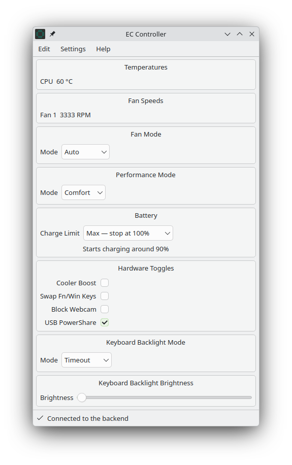
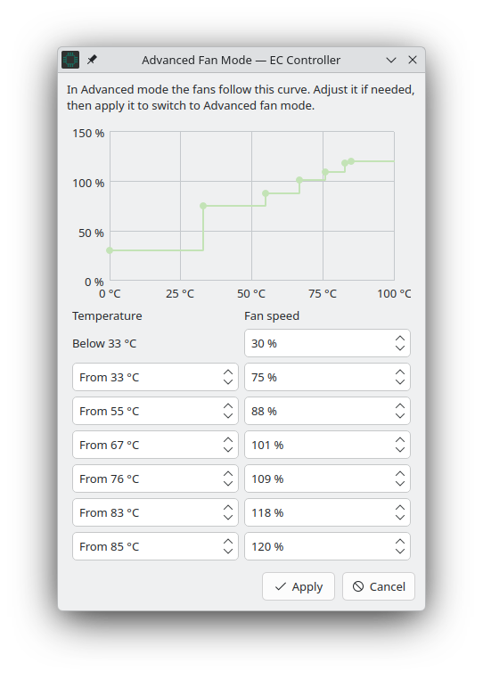

# EC Controller

A modern graphical control panel and background service for MSI laptops on Linux. EC Controller allows you to configure fan curves, performance profiles, battery charging thresholds, keyboard backlights, and hardware switches through the `msi-ec` kernel driver.

> **Disclaimer:** EC Controller is an independent, unofficial open-source project. MSI is a registered trademark of Micro-Star International Co., Ltd. This project is not affiliated with, endorsed by, sponsored by, or supported by MSI.

---

## Screenshots

<!--
To display images:
1. Place your PNG/JPEG screenshots in the `screenshots/` directory (e.g., `screenshots/main-window.png` and `screenshots/fan-curve-editor.png`).
2. Make sure the filenames match the relative links below.
3. Commit and push the `screenshots/` folder to your GitHub repository.
-->

| Main Application Window | Advanced Fan Curve Editor |
| :---: | :---: |
|  |  |
| *Real-time monitoring, performance modes, battery limits, and hardware toggles.* | *Fan curve chart and threshold adjustments.* |

---

## Hardware Driver Requirement (`msi-ec`)

EC Controller communicates with your laptop's Embedded Controller (EC) via sysfs interfaces exposed by the **`msi-ec`** kernel module.

To access all features (including custom fan curves, battery charge thresholds, and keyboard backlight controls), you must use the updated driver fork:

- **Required driver fork:** [**Fede2782/msi-ec**](https://github.com/Fede2782/msi-ec)

### Model Support & Hardware Compatibility

- **Model Support:** Because Embedded Controller memory layouts differ across laptop models and motherboard revisions, **currently only certain MSI models have full feature support**.
- **Driver Contributions Welcome:** If your model has partial support or lacks specific EC tables, contributions and Pull Requests to the [msi-ec driver repository](https://github.com/Fede2782/msi-ec) to extend hardware profiles for additional models are warmly welcomed!

---

## Features

EC Controller queries sysfs dynamically and displays only the features supported by your specific laptop model:

- **Real-Time Hardware Monitoring:**
  - Live CPU and GPU temperatures.
  - Live fan RPM speeds for up to four fans (CPU, GPU, and auxiliary fans).
  - "Show all fan slots" option to inspect auxiliary or inactive fan channels.
- **Fan Modes & Fan Curve Editor:**
  - Preset modes: *Auto*, *Silent*, *Basic*, and *Advanced*.
  - Selecting *Advanced* opens the fan curve editor featuring a curve chart, synchronized temperature/speed thresholds, and safety constraint validation (strictly increasing temperatures, monotonic fan speeds, and an 85%+ emergency top-speed floor).
- **Performance Modes (Shift Modes):**
  - Switch between *Comfort*, *Turbo*, *Eco*, and *Sport* profiles.
- **Battery Health Management:**
  - Charge thresholds: *100% (Full Charge)*, *80% (Balanced)*, *60% (Maximum Lifespan)*, or custom thresholds.
  - Automatically manages the hardware charge start threshold delta (10%) to minimize battery wear.
- **Hardware Toggles:**
  - *Maximum cooling* (instant maximum fan speed).
  - *Fn / Windows Key Swap*.
  - *Webcam Lock* (hardware-level camera disable).
  - *USB PowerShare* (power USB devices while laptop is sleeping or off).
- **Keyboard Backlight:**
  - Modes (*Always On*, *Timeout*).
  - Brightness control integrated with system backlight settings (UPower).
  - The [Fede2782/msi-ec](https://github.com/Fede2782/msi-ec) driver reports brightness changes to userspace so your desktop environment can display on-screen graphics (OSD notifications) when brightness is changed.
- **Desktop & System Integration:**
  - **System Tray:** Minimizes to tray on close with custom Breeze and Breeze Dark SVG themes.
  - **Start at Login:** Automatically launches minimized into the system tray at user login (configurable in Settings).
  - **State Persistence:** Settings are saved to `/etc/eccontroller.conf` by the backend and automatically restored across system reboots.
  - **KDE Plasma Extras:**
    - Pre-mapped keyboard shortcuts for cycling performance (Shift) modes (with desktop notifications) and flipping the display 180° via `kscreen-doctor` (with orientation restored on quit).
    - Both the Shift Mode and Rotate Window actions can be customized or rebound to other keys in KDE *System Settings → Shortcuts*.
  - **Customizable Layout (Edit Mode):** Reorder and organize feature boxes to suit your workflow.

---

## Architecture & Security

EC Controller uses a split, privilege-separated design:

1. **`ec-controller` (GUI Application):** Runs unprivileged under your user session. It reads sysfs sensor and status files directly (read-only) and renders the Qt 6 / KDE interface.
2. **`ec-controller-service` (Root D-Bus Service):** Runs as a root system daemon on the system D-Bus (`org.fedelabs.EcController`). It is the only component with authority to write to sysfs.
3. **Polkit Authorization:** All write actions are authorized via Polkit (`org.fedelabs.EcControllerAPI.write`). Active desktop users in the administrative group (`wheel` / `sudo`) are authorized directly, while non-administrative sessions are prompted for credentials.

---

## Target Distributions & Requirements

- **Primary Development & Testing Target:** **Fedora KDE** (Fedora 43+ / 44+), **Debian 13 (Trixie)**, and **Ubuntu LTS KDE** (Ubuntu 26.04 LTS).
- **Desktop Environment:** Designed for **KDE Plasma 6 (Wayland)**. Also functions on X11 and other desktop environments (GNOME, XFCE, etc.), with KDE-specific shortcuts and display-flip features gracefully bypassed.
- **Runtime Dependencies:**
  - Linux Kernel with the [Fede2782/msi-ec](https://github.com/Fede2782/msi-ec) driver loaded.
  - Qt 6 (≥ 6.8.0: Core, Widgets, DBus).
  - KDE Frameworks 6 (≥ 6.13.0: CoreAddons, GlobalAccel, Notifications).
  - Polkit-Qt6 (`polkit-qt6-1`).
  - systemd, D-Bus, and Polkit daemons.

---

## Installation

### Fedora (COPR Repository)

[](https://copr.fedorainfracloud.org/coprs/fede2782/ec-controller/package/ec-controller/)

On **Fedora 43+**, enable the [`fede2782/ec-controller`](https://copr.fedorainfracloud.org/coprs/fede2782/ec-controller/) COPR repository to install EC Controller and receive automatic updates through `dnf`, KDE Discover, or GNOME Software:

```bash
sudo dnf copr enable fede2782/ec-controller
sudo dnf install ec-controller
```

### Pre-Built Packages (.deb / .rpm)

Pre-built binary packages generated by GitHub Actions CI are attached to each [Release](https://github.com/Fede2782/ec-controller/releases):

- **Debian 13 (.deb):**
  ```bash
  sudo apt install ./ec-controller_*~deb13_*.deb
  ```

- **Ubuntu 26.04 LTS (.deb):**
  ```bash
  sudo apt install ./ec-controller_*~ubuntu26.04_*.deb
  ```

- **Fedora 44 (.rpm):**
  ```bash
  sudo dnf install ./ec-controller-*.rpm
  ```

Installing the package automatically registers the D-Bus policy, Polkit rules, icons, and autostart entries, and enables and starts the `org.fedelabs.eccontroller.service` systemd service.

---

## Building from Source

Build dependencies and flags match the project's GitHub Actions workflow (`.github/workflows/packages.yml`).

### 1. Install Build Dependencies

**Debian 13 / Ubuntu 26.04 LTS:**
```bash
sudo apt update
sudo apt install -y --no-install-recommends \
    build-essential cmake dpkg-dev file \
    extra-cmake-modules qt6-base-dev qt6-base-dev-tools \
    qt6-tools-dev qt6-tools-dev-tools \
    libkf6coreaddons-dev libkf6globalaccel-dev libkf6notifications-dev \
    libpolkit-qt6-1-dev
```

**Fedora 44:**
```bash
sudo dnf install -y \
    gcc-c++ make cmake rpm-build desktop-file-utils systemd-rpm-macros \
    extra-cmake-modules qt6-qtbase-devel qt6-qttools-devel \
    kf6-kcoreaddons-devel kf6-kglobalaccel-devel kf6-knotifications-devel \
    polkit-qt6-1-devel
```

### 2. Configure and Build

> **Important:** Always configure with `-DCMAKE_INSTALL_PREFIX=/usr`. Standard system directories (`/usr/share/dbus-1/system.d`, `/usr/share/polkit-1/actions`, `/usr/lib/systemd/system`) are required for D-Bus security policies, Polkit actions, and the systemd unit to be discovered by the operating system.

```bash
# Configure
cmake -B build -DCMAKE_BUILD_TYPE=Release -DCMAKE_INSTALL_PREFIX=/usr

# Compile
cmake --build build --parallel
```

### 3. Install or Package

**To install directly to the system:**
```bash
sudo cmake --install build
```
*(Direct installation automatically reloads systemd and enables/starts `org.fedelabs.eccontroller.service`.)*

**To build distribution packages (CPack):**
```bash
cd build

# On Debian / Ubuntu:
cpack -G DEB

# On Fedora:
cpack -G RPM
```

---

## Service Management & Troubleshooting

- **Check Service Status:**
  ```bash
  systemctl status org.fedelabs.eccontroller.service
  ```
- **Service Logs:**
  ```bash
  journalctl -u org.fedelabs.eccontroller.service -f
  ```
- **Driver Verification:**
  Verify that the `msi-ec` module is loaded:
  ```bash
  ls -d /sys/devices/platform/msi-ec
  ```
  If this directory does not exist, load the driver:
  ```bash
  sudo modprobe msi-ec
  ```
- **"Not connected to backend" in Status Bar:**
  Ensure the background service is running (`sudo systemctl start org.fedelabs.eccontroller.service`), then press **F5** in the main window to reconnect.

---

## Contributing

Contributions of any kind are welcomed!

- **EC Controller:** Pull Requests and issues for UI improvements, translations, and desktop integrations are encouraged. Please consult [`docs/GUI-DEVELOPER-GUIDE.md`](docs/GUI-DEVELOPER-GUIDE.md) for architectural patterns and coding conventions.
- **Hardware Support (msi-ec):** If your MSI laptop model needs new EC configuration tables or feature mapping, please submit Pull Requests to [Fede2782/msi-ec](https://github.com/Fede2782/msi-ec).

---

## Credits

Special thanks to the developers and projects that make this work possible:

- **[BeardOverflow](https://github.com/BeardOverflow)** — Author of the foundational [`msi-ec`](https://github.com/BeardOverflow/msi-ec) Linux kernel driver.
- **[BeardOverflow/msi-ec PR #143](https://github.com/BeardOverflow/msi-ec/pull/143)** — Implementation of the fan curve sysfs interface.
- **[RisenID](https://github.com/RisenID)** — Collaborator and contributor.

---

## License

EC Controller is released under the **GNU General Public License v3.0** (GPLv3). See the [LICENSE](LICENSE) file for the full license text.
